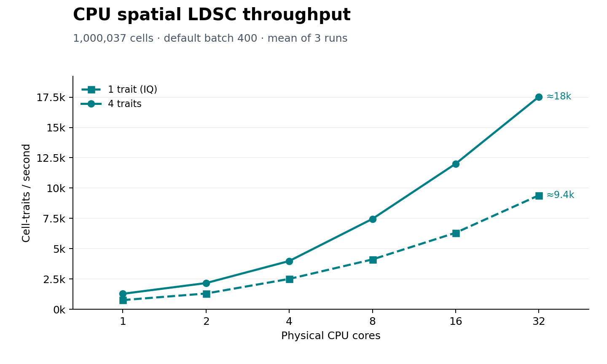
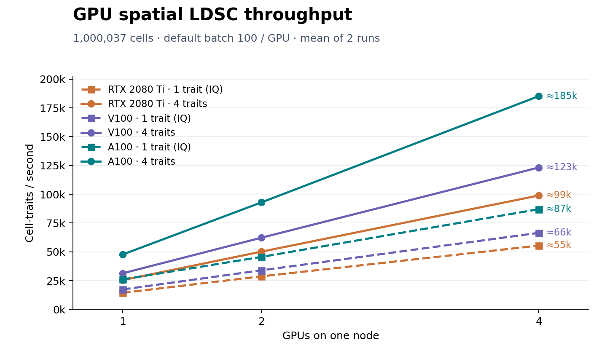

# Performance and scalability

Use this guide to choose resources, reduce memory use and reuse completed work.
For the biological workflow and the meaning of GSS, see {doc}`key_concepts`.
For graph, matching or input changes, see {doc}`advanced_usage`.

## Example used in this guide

All examples use **mouse embryo E16.5 E1S1 in Spatial2D mode**. Download its files
using the {doc}`2d_tutorial/mouse_embryo`, then run from `gsmap_tutorials/`.
There is no cross-section matching in this example. Keep the tutorial's graph
and homogeneous-neighbor defaults unchanged when comparing performance.

```text
gsmap_tutorials/
├── resources/
│   ├── 1000g-hc-grch38-v50-eur/
│   │   ├── snp_gene_weights.h5ad
│   │   └── w_ld/
│   └── homologs/mouse_human_homologs.txt
├── example_data/
│   ├── mouse-e16-mosta/ST/E16.5_E1S1.MOSTA.h5ad
│   └── example-traits/
│       ├── IQ.sumstats.gz
│       ├── Height.sumstats.gz
│       ├── MCHC.sumstats.gz
│       └── gwas.yaml                 # Trait list shown below
└── results/mouse-e16-mosta/           # Created by the analysis
```

Complete commands below have **CLI/Python tabs**. Choose one interface.
Short CLI flag excerpts are marked as text: add or replace them in a complete
command. Python tuning snippets modify its `config` **before**
`run_quick_mode(config)`. They are not separate analyses.

## Performance recommendations

- **Start with the defaults.** Measure the whole step, including loading and saving.
- **Use a GPU when helpful.** Try one GPU for the compute-heavy stages; extra
  workers or devices do not guarantee a faster run.
- **Use an SSD if I/O is slow.** It is optional; project storage is supported.
- **Run multiple traits together.** Reuse GSS and share LD-score construction
  within one run, rather than repeating it in a separate job for each trait.
- **Leave room for memory and output.** More workers and larger batches can
  increase memory use. Download size is not working disk space.

## Choose CPU or GPU

Embedding uses PyTorch and a visible CUDA GPU when available.
`--use-gpu` / `--no-gpu` selects the device for marker scoring and spatial LDSC.
Spatial LDSC automatically chooses an optimized CPU or GPU regression backend;
you do not need to select a kernel implementation.

### GPU run

Use the defaults or set GPU use explicitly:

````{tab} CLI
```text
--use-gpu
```
````

````{tab} Python
```python
config.use_gpu = True
```
````

### CPU-only run

Before starting the CLI or Python process, hide CUDA devices:

```bash
export CUDA_VISIBLE_DEVICES=""
```

Then choose CPU execution. This example uses up to **16 compute threads** for
the default regression model. Use a count suitable for your allocated cores:

````{tab} CLI
```text
--no-gpu
--ldsc-compute-workers 16
```
````

````{tab} Python
```python
config.use_gpu = False
config.ldsc_compute_workers = 16
```
````

```{note}
`--no-gpu` alone does not disable PyTorch embedding on a visible GPU.
Set the environment before imports for a fully CPU-only run. For a GPU job,
use a fresh shell without the CPU-only override and respect scheduler-assigned devices.
```

The default CPU model uses a fused Numba backend. Its effective compute-thread
count is capped by the requested workers, available CPU affinity, Numba's thread
limit and the scheduler's CPU allocation when present. Reader and writer threads
share those resources; this option is not a global thread limit for every library.
Additional baseline annotations remain supported through the general JAX backend.

### Multiple GPUs on one node

For a node with four allocated, visible GPUs, add:

````{tab} CLI
```text
--use-gpu
--ldsc-num-gpus 4
```
````

````{tab} Python
```python
config.use_gpu = True
config.ldsc_num_gpus = 4
```
````

gsMap divides cells into nonoverlapping ranges. **Each GPU processes all traits**
for its assigned cells, sharing LD scores across those traits. Once workers
succeed, results are merged in cell order into the usual per-trait files.
No manual splitting or merging is needed.

This setting applies to spatial LDSC, not embedding or marker scoring. It uses
GPUs on **one node**, requires shared-LD mode (enabled by default), and does not
request GPUs from a scheduler. Leave enough CPU cores for all GPU workers;
the measured GPU runs below used eight physical CPU cores per GPU.

## I/O and fast storage

Ranks and marker scores are stored on disk and read as needed. Use
`--memmap-tmp-dir` to place eligible temporary arrays on a fast **SSD or NVMe**
disk. Without it, gsMap uses project storage.

1. Choose an existing, writable directory on the fast disk.
2. Check that it has room for uncompressed arrays and temporary copies.
3. Keep the project on persistent storage and let synchronization finish.

For example, if `/fast-ssd/gsmap` is a directory on your SSD:

````{tab} CLI
```text
--memmap-tmp-dir /fast-ssd/gsmap
```
````

````{tab} Python
```python
from pathlib import Path

config.memmap_tmp_dir = Path("/fast-ssd/gsmap")
```
````

New ranks can be written to scratch first and synchronized back to the project.
If staging cannot fit safely, gsMap falls back to project storage and logs the
decision. Compare runtime including those copies.

Shared-LD runs can stage and reuse a read-only marker cache on the selected
disk. NumPy/memmap input uses up to four reader threads with up to eight chunks
in flight; shared HDF5/file readers use one reader. These are **marker-input
chunks**, not a cache of LD scores for the whole dataset. Prefetching overlaps
input preparation with computation without loading the entire matrix into RAM.

```{tip}
This setting selects disk storage, not RAM or GPU memory. A directory named
`scratch` on the same slow filesystem is not faster.
```

A float16 matrix needs `2 × cells × genes` bytes: one million cells × 20,000
genes is about **40 GB per matrix**. Ranks, marker scores and temporary copies
can coexist. This is a disk-size estimate, not a peak-RAM estimate.

## Tune memory and throughput

1. **Identify the limiting step** in its log.
2. **Change one setting** on the same input.
3. **Compare total time and memory**, not just a batch's cells/s.

| Setting | Default | When to adjust |
|---|---|---|
| `--mkscore-batch-size` | `0` (automatic) | Set a smaller explicit batch if marker-score computation runs out of memory. |
| `--spots-per-chunk-quick-mode` | Automatic: **CPU 400, GPU 100** | Cells per compute chunk, per device. An explicit positive value overrides automatic selection. |
| `--ldsc-read-workers` | `10` | Shared-LD input prefetch uses at most four readers for NumPy/memmap input and one for shared file handles. |
| `--ldsc-gwas-workers` | `16` | Concurrent GWAS preparation, capped at 16 files in flight and available CPU cores. Use fewer workers to reduce temporary memory. |
| `--ldsc-compute-workers` | `10` | Requested compute threads for the default CPU model; use the cores allocated to your run. |
| `--ldsc-trait-batch-size` | `4` | Traits processed together within a shared-LD chunk; range 1–16. Not a limit on the total number of traits. |
| `--ldsc-num-gpus` | `1` | GPUs used for spatial LDSC on one node. |
| `--ldsc-share-ld` | Enabled | Reuse each LD-score chunk across all requested traits. |
| `--ldsc-regression-backend` | `auto` | Optimize the common model automatically; retain general JAX support for other designs. |

### How the automatic batch size is displayed

The CLI help shows `auto: CPU=400, GPU=100`. Omit
`--spots-per-chunk-quick-mode` to use it. In Python, omit
`spots_per_chunk_quick_mode` or set it to `None`; in a quick-mode YAML
configuration, omit the field or use `null`.

The actual execution device determines the batch, including a fallback from
GPU to CPU. The spatial-LDSC log records the resolved value, for example:

```text
Spatial LDSC batch size: 400 spots/chunk (auto: CPU)
```

An explicit value such as `--spots-per-chunk-quick-mode 100` stays 100 on
either device. With multiple GPUs, the automatic value is **100 per GPU**.

### Explicit smaller batches

For example, test these lower-memory settings. A marker batch of 50 helps only
if it is smaller than the effective batch reported in your log.

````{tab} CLI
```text
--mkscore-batch-size 50
--spots-per-chunk-quick-mode 25
```
````

````{tab} Python
```python
config.mkscore_batch_size = 50
config.spots_per_chunk_quick_mode = 25
```
````

```{note}
Batching does not remove a cell's selected neighbors. gsMap loads its complete
selected neighborhood before scoring, even when the rank rows are far apart.
These settings change how work is scheduled, not which cells enter the analysis.
```

More workers are not always faster. CPU computation, readers and writers share
memory bandwidth and I/O. Larger batches amortize overhead, but neither doubling
threads nor doubling a batch guarantees twice the throughput. Increasing
`--ldsc-compute-workers` does not create extra GPU workers; use
`--ldsc-num-gpus` for that. See {doc}`cli_reference` for all controls.

## Multiple traits with shared LD scores

Download the example GWAS bundle from {doc}`downloads`, if needed, and
save this small trait list as `example_data/example-traits/gwas.yaml`:

```yaml
IQ: IQ.sumstats.gz
Height: Height.sumstats.gz
MCHC: MCHC.sumstats.gz
```

Paths are relative to the YAML file. Pass `--sumstats-config-file` (Python:
`sumstats_config_file`) instead of `--trait-name` and `--sumstats-file`.
The complete association command is below.

For each cell chunk, gsMap reads GSS once, constructs SNP × cell LD scores
once, then runs the requested GWAS regressions in small trait groups. The
default group size is four: a file with 127 traits processes **all 127**, not
only the first four. Output writing overlaps computation.

Only reusable computation is shared. Each trait keeps its own retained SNPs,
sample sizes, regression weights and jackknife blocks; the GWAS are not pooled
and are not restricted to a single common SNP intersection. Group traits that
use the **same reference panel and SNP × gene matrix** in one run. Use separate
runs for different reference ancestries or annotation builds.

The common model (spatial GSS LD score, base, all-gene and intercept) benefits
from gene-space initialization and fused regression statistics. Extra baseline
annotations use the general backend automatically. Trait grouping bounds
temporary regression workspaces, but host memory still grows with prepared
GWAS inputs. Start with the default group size before increasing it.

## Spatial LDSC throughput at a glance

**Cell-traits/s** is the number of cell–trait associations completed per second
(cells × traits / time). Dashed lines show **one trait (IQ)**; solid lines show
**four traits together**. Higher is faster. Both tests use the same
**1,000,037 HESTA CS20 cells**.

### CPU

AMD EPYC, 1–32 physical cores, **default batch 400**.



### GPU

A100, V100 and RTX 2080 Ti, 1–4 GPUs, **default batch 100 per GPU**.



Measured with node-local SSD, including loading and output writing but excluding
initial staging and JIT warmup. These are throughput measurements, not full
CLI startup times; actual speed depends on your data and hardware.

{download}`Measurements and test details <_static/benchmarks/README.md>` ·
{download}`Download CSV <_static/benchmarks/trait_scaling_measurements.csv>`

## Cluster users

Run preprocessing once, then run the trait list together. The same workflow
works on a workstation; a cluster simply supplies the allocated CPUs or GPUs.

1. **Preprocess once.** Calculate embeddings and GSS.
2. **Allocate resources.** Run on a compute node, not a login node. Set worker
   counts for the CPUs assigned to the job, not the whole node.
3. **Run shared multi-trait LDSC.** Use multiple CPU cores or GPUs within one job.
   Do not launch overlapping jobs that write the same trait result files.
4. **Check completion, then report.** Wait for all traits and any GPU workers to
   finish. Generate the combined report once.

### Example: calculate embeddings and GSS

Skip this example if the E16.5 tutorial has already completed these stages.
It uses `count`, `annotation`, `spatial` and the mouse–human homolog file,
just like the tutorial. It stops before spatial LDSC.

````{tab} CLI
```bash
mkdir -p results
gsmap quick-mode \
    --workdir results \
    --project-name mouse-e16-mosta \
    --dataset-type spatial2D \
    --h5ad-path example_data/mouse-e16-mosta/ST/E16.5_E1S1.MOSTA.h5ad \
    --homolog-file resources/homologs/mouse_human_homologs.txt \
    --species MOUSE_GENE_SYM \
    --annotation annotation \
    --spatial-key spatial \
    --data-layer count \
    --trait-name IQ \
    --sumstats-file example_data/example-traits/IQ.sumstats.gz \
    --plot-origin lower \
    --stop-step latent2gene
```
````

````{tab} Python
```python
from gsMap.config import QuickModeConfig
from gsMap.pipeline import run_quick_mode

config = QuickModeConfig(
    workdir="results",
    project_name="mouse-e16-mosta",
    dataset_type="spatial2D",
    h5ad_path=["example_data/mouse-e16-mosta/ST/E16.5_E1S1.MOSTA.h5ad"],
    homolog_file="resources/homologs/mouse_human_homologs.txt",
    species="MOUSE_GENE_SYM",
    annotation="annotation",
    spatial_key="spatial",
    data_layer="count",
    trait_name="IQ",
    sumstats_file="example_data/example-traits/IQ.sumstats.gz",
    plot_origin="lower",
    stop_step="latent2gene",
)
run_quick_mode(config)
```
````

### Example: multiple traits in one run

After preprocessing finishes, submit the following command in a compute job.
`--start-step spatial_ldsc --stop-step spatial_ldsc` runs only association
testing; it reuses the saved GSS. Shared LD and automatic regression selection
are enabled by default. This command uses one GPU; apply the CPU or multi-GPU
settings above to change the execution resources.

````{tab} CLI
```bash
gsmap quick-mode \
    --workdir results \
    --project-name mouse-e16-mosta \
    --dataset-type spatial2D \
    --annotation annotation \
    --start-step spatial_ldsc \
    --stop-step spatial_ldsc \
    --w-ld-dir resources/1000g-hc-grch38-v50-eur/w_ld \
    --snp-gene-weight-adata-path resources/1000g-hc-grch38-v50-eur/snp_gene_weights.h5ad \
    --sumstats-config-file example_data/example-traits/gwas.yaml
```
````

````{tab} Python
```python
from gsMap.config import QuickModeConfig
from gsMap.pipeline import run_quick_mode

config = QuickModeConfig(
    workdir="results",
    project_name="mouse-e16-mosta",
    dataset_type="spatial2D",
    annotation="annotation",
    start_step="spatial_ldsc",
    stop_step="spatial_ldsc",
    w_ld_dir="resources/1000g-hc-grch38-v50-eur/w_ld",
    snp_gene_weight_adata_path="resources/1000g-hc-grch38-v50-eur/snp_gene_weights.h5ad",
    sumstats_config_file="example_data/example-traits/gwas.yaml",
)
run_quick_mode(config)
```
````

Add more traits to `gwas.yaml` to reuse the same GSS. Previously completed trait
files are skipped. If you change GWAS contents, the LD reference or analysis
settings, use a new output project as described in {doc}`advanced_usage`;
the existence of an old result is not evidence that it matches new inputs.

```{important}
Keep the complete `latent_to_gene/` directory, including metadata, the
observation-index mapping and `concatenated_latent_adata.h5ad`. Use persistent
project storage; node-local SSD may disappear after a job ends.
See {doc}`output_files` for the files needed to reuse scores.
```

For an exceptionally large single trait, `--cell-indices-range` can split LDSC
into nonoverlapping ranges. This is an advanced option: merge partial results
and verify complete coverage with no duplicate cells before enrichment/reporting.
For GPUs on the same node, prefer `--ldsc-num-gpus`, which handles splitting
and merging automatically. Independent jobs on different nodes remain an
option, but separate trait jobs repeat LD-score construction and can saturate
shared storage.

## Keep large reports responsive

Report limits control browser views and diagnostic plots, **not which cells**
enter spatial LDSC.

| CLI flag | Default | Scope |
|---|---|---|
| `--downsampling-n-spots-2d` | `300000` | Displayed spots per section. |
| `--downsampling-n-spots-3d` | `200000` | Displayed spots in the combined 3D view. |
| `--downsampling-n-spots-umap` | `50000` | Spots used for each report UMAP. |
| `--downsampling-n-spots-pcc` | `20000` | Sampled spots for GSS correlations. |
| `--top-corr-genes` | `10` | Top correlated genes per trait for expression/GSS diagnostic plots and Manhattan highlights. |

The default generates diagnostic plots for the top 10 correlated genes per
trait. Use `--top-corr-genes 50` (Python: `top_corr_genes=50`) for more gene
plots at a higher report-generation cost. This limit does not change spatial
LDSC, enrichment results, or the complete gene-correlation tables.

The defaults display all analyzed E16.5 E1S1 spots. A lower 2D cap of 150,000
also covers this example and reduces browser load for larger datasets. Leave
UMAP and correlation limits unchanged unless you need more detail.

````{tab} CLI
```text
--downsampling-n-spots-2d 150000
```
````

````{tab} Python
```python
config.downsampling_n_spots_2d = 150000
```
````

### Example: finish enrichment and the report

After **all three traits** finish, this runs Cauchy enrichment and builds
the combined report with a 150,000-spot 2D display limit, without recalculating
embeddings, GSS or spatial LDSC.

````{tab} CLI
```bash
gsmap quick-mode \
    --workdir results \
    --project-name mouse-e16-mosta \
    --dataset-type spatial2D \
    --annotation annotation \
    --spatial-key spatial \
    --plot-origin lower \
    --start-step cauchy \
    --sumstats-config-file example_data/example-traits/gwas.yaml \
    --downsampling-n-spots-2d 150000
```
````

````{tab} Python
```python
from gsMap.config import QuickModeConfig
from gsMap.pipeline import run_quick_mode

config = QuickModeConfig(
    workdir="results",
    project_name="mouse-e16-mosta",
    dataset_type="spatial2D",
    annotation="annotation",
    spatial_key="spatial",
    plot_origin="lower",
    start_step="cauchy",
    sumstats_config_file="example_data/example-traits/gwas.yaml",
    downsampling_n_spots_2d=150000,
)
run_quick_mode(config)
```
````

Use the same trait list for association testing and reporting. The
{doc}`advanced_usage` describes additional GWAS configuration options.

## Where the work happens

The biological workflow diagram is in
{ref}`Key Concepts <pipeline-overview>`. For performance diagnosis,
start with the log for the slow step:

| Step | What to check | Log under `logs/latest/` |
|---|---|---|
| Embeddings | Expression preparation, graph size, training and device memory | `01_find_latent.log` |
| Ranks and marker scores | Expression/rank reading, score computation and output I/O | `02_latent_to_gene.log` |
| Spatial LDSC | GSS-to-LD transformation and regression time | `03_spatial_ldsc.log` and per-trait logs |
| Report | Plots, UMAP, sampled GSS reads and browser payload size | `05_report.log` |

For example, inspect the end of the E16.5 marker-score log:

```bash
tail -n 40 results/mouse-e16-mosta/logs/latest/02_latent_to_gene.log
```

Look at sustained timings across the step. Brief pauses or low GPU utilization
do not, by themselves, identify the bottleneck. See {doc}`output_files` for
the full log layout and {doc}`advanced_usage` for safe restart settings.
